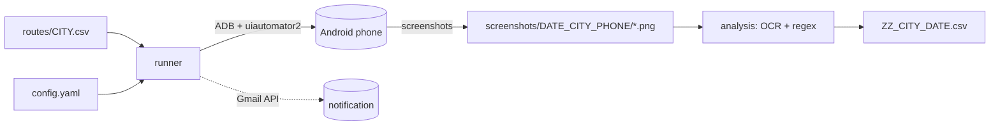

# AppAutomation

Automate Android ride-hailing apps (**Bolt**, **inDrive**) and **Google Maps** on real phones,
capture fare screenshots for a list of routes, and extract prices, fees, distances and
durations from those screenshots with OCR.

* Drives the phone with [uiautomator2](https://github.com/openatx/uiautomator2) over ADB.
* Reads routes (pickup → drop-off) from CSV files, for any number of cities and phones.
* Extracts fares with a pluggable OCR back-end: EasyOCR, PaddleOCR or Tesseract.
* Writes one result CSV per run and can notify you by e-mail (Gmail API) when a run ends.

> [!WARNING]
> This tool automates third-party apps through the UI. Check the terms of service of the
> apps you automate and use it responsibly. Screen coordinates and element ids change with
> app versions, so drivers may need adjusting.

---

## Table of contents

1. [How it works](#how-it-works)
2. [Project layout](#project-layout)
3. [Installation](#installation)
4. [Configuration](#configuration)
5. [Routes](#routes)
6. [Usage](#usage)
7. [Output](#output)
8. [OCR engines](#ocr-engines)
9. [E-mail notifications](#e-mail-notifications)
10. [Examples](#examples)
11. [Extending: add an app or a phone](#extending-add-an-app-or-a-phone)
12. [Troubleshooting](#troubleshooting)
13. [Security notes](#security-notes)
14. [Development](#development)

---

## How it works



1. **Capture** – for every route, each app of the task is opened, the pickup and drop-off are
   typed in and screenshots are saved as `<CITY><DATE><ID:03d><SUFFIX>.png`. A failed app is
   retried once; the run aborts after 3 failed routes.
2. **Analyse** – regions of each screenshot are cropped, read with OCR and parsed with regular
   expressions into one CSV row per route.

| Suffix | Screen                         | Producer   |
|--------|--------------------------------|------------|
| `B`    | Bolt ride options (fare)       | Bolt       |
| `BI`   | Bolt fare breakdown            | Bolt       |
| `IN`   | inDrive offer screen           | inDrive    |
| `G`, `G0`, `G1` | Google Maps route + alternatives | Google Maps |

## Project layout

```
AppAutomation/
├── src/appautomation/
│   ├── cli.py            # command line entry point
│   ├── runner.py         # capture loop, retries, analysis hand-off
│   ├── config.py         # YAML configuration (dataclasses)
│   ├── constants.py      # cities, task->apps map, screen regions, fee labels
│   ├── naming.py         # task names, address expansion, file naming
│   ├── routes.py         # route CSV loading / filtering
│   ├── device.py         # ADB / uiautomator2 connection, unlock
│   ├── notify.py         # optional Gmail notifications
│   ├── text_utils.py     # OCR text -> numbers
│   ├── apps/             # one driver per app (base, bolt, indrive, google_maps)
│   └── analysis/         # OCR engines, screenshot parser, batch analyser
├── examples/             # runnable examples
├── tests/                # unit tests (no phone / OCR needed)
├── routes/example.csv    # sample route list
├── config.example.yaml   # copy to config.yaml
├── credentials.example.json
└── docs/                 # GPU_SETUP, REQUIREMENTS, DESIGN, TEST_PLAN, MULTI_DEVICE_PLAN
```

## Design & process documents

| Document | Contents |
|----------|----------|
| [docs/REQUIREMENTS.md](docs/REQUIREMENTS.md) | Requirements spec: user stories, functional / non-functional requirements, acceptance criteria |
| [docs/DESIGN.md](docs/DESIGN.md) | Design document: module map, key design decisions, data flow, extension points |
| [docs/TEST_PLAN.md](docs/TEST_PLAN.md) | Test plan: unit → OCR accuracy benchmark, device checklists, system scenarios, CI strategy |
| [docs/MULTI_DEVICE_PLAN.md](docs/MULTI_DEVICE_PLAN.md) | Proposal: multi-phone / multi-app parallel operation (orchestrator, job definition, phased plan) |
| [docs/GPU_SETUP.md](docs/GPU_SETUP.md) | EasyOCR GPU setup |

## Installation

Requirements: **Python ≥ 3.9**, **ADB** ([platform-tools](https://developer.android.com/tools/releases/platform-tools)),
an Android phone with *USB debugging* enabled.

```bash
git clone https://github.com/<you>/AppAutomation.git
cd AppAutomation
python -m venv .venv && . .venv/bin/activate        # Windows: .venv\Scripts\activate

pip install -e .                  # core
pip install -e ".[easyocr]"       # + one OCR engine: easyocr | paddle | tesseract
pip install -e ".[gmail]"         # optional e-mail notifications
pip install -e ".[dev]"           # tests
```

Verify the phone is visible: `adb devices` (note the serial number).

## Configuration

```bash
cp config.example.yaml config.yaml     # config.yaml is git-ignored
```

| Key              | Description |
|------------------|-------------|
| `work_base`      | Root folder containing `routes/`, `screenshots/`, `logs/`. |
| `adb_path`       | Path to `adb` (default: `adb` from `PATH`). |
| `tesseract_cmd`  | Path to `tesseract` (only if not on `PATH`). |
| `ocr_engine`     | `auto`, `easyocr`, `paddleocr`, `tesseract`. |
| `ocr_gpu`        | Use the GPU for EasyOCR. |
| `phones`         | Alias → `{serial, profile}`. The alias is what you pass to `--phone`. |
| `partial_routes` | Route ids recorded with `--partial`. |
| `email`          | Optional Gmail sender/recipient (see below). |

The config file is searched in this order: `--config PATH` → `$APPAUTOMATION_CONFIG` → `./config.yaml`.

**Screen profiles.** OCR regions are pixel boxes `(top, bottom, left, right)` stored in
`SCREEN_PROFILES` in [`constants.py`](src/appautomation/constants.py). The bundled `hd720`
profile was tuned on a 720 × 1560 screen. For another resolution add a profile and reference
it in `phones.<alias>.profile`.

## Routes

`<work_base>/routes/<CITY>.csv`, columns `id,src,dst`:

```csv
id,src,dst
1,Federation Square,Melbourne Airport
2,Queen Victoria Market,Flinders Street Station
```

`TIME_*` tasks (scheduled recording) additionally need `hour,minute` columns – see
[`examples/routes_scheduled.csv`](examples/routes_scheduled.csv).

Addresses are expanded with state/city/country from the city code (`address_adapt`), e.g.
`Federation Square` + `MEL` → `VIC,Federation Square,Melbourne`.

## Usage

```bash
appautomation --phone PHONE --city TASK --date DATE --start N --end M [options]
# or: python -m appautomation ...
```

| Argument         | Meaning |
|------------------|---------|
| `--phone`        | Phone alias from `config.yaml`. |
| `--city`         | Task name (see below). |
| `--date`         | Label used in file names, e.g. `0906`. `0000` = today (`MMDD`). |
| `--start/--end`  | Inclusive route id range. The special start values `400`, `404`, `900` pick an hourly batch of 4 / 4 / 9 routes based on the current hour. |
| `--analyse`      | Only analyse existing screenshots; the phone is not touched. |
| `--capture-only` | Capture, but skip the OCR step (handy on machines without OCR). |
| `--partial`      | Only record the ids in `partial_routes`. |
| `--config`       | Config file path. |

### Task names (`--city`)

`[APP_]CITY[_SERVICE]`, upper case. `CITY` selects `routes/CITY.csv`.

| Task                    | Apps driven (in order) | Analysis |
|-------------------------|------------------------|----------|
| `MEL`, `BOLT_MEL`       | Bolt → Google Maps     | yes |
| `INDRIVE_MEL`           | inDrive                | no (screenshots only) |
| `GOOGLE_MEL`            | Google Maps            | yes |
| `TIME_MEL` (file `TIME_MEL.csv`) | Bolt, at each route's `hour:minute` | no |

City codes (`MEL`, `SYD`, `ADL`, `PER`, `BNE`, `GLD`, `AUK`, `WLG`, …) are defined in
[`constants.py`](src/appautomation/constants.py).

### Typical commands

```bash
# record routes 1-10 with Bolt + Google Maps, then analyse
appautomation --phone phone_a --city BOLT_MEL --date 0000 --start 1 --end 10

# only analyse screenshots recorded earlier
appautomation --phone phone_a --city BOLT_MEL --date 0906 --start 1 --end 10 --analyse

# record inDrive prices only
appautomation --phone phone_a --city INDRIVE_MEL --date 0000 --start 1 --end 10
```

## Output

```
<work_base>/
├── logs/<DATE>_<TASK>_<PHONE>.log
└── screenshots/[time/]<DATE>_<CITY>_<PHONE>/
    ├── MEL0906001B.png, MEL0906001BI.png, MEL0906001G.png …
    └── ZZ_MEL_0906.csv          # analysis result
```

Result columns: `id, date, time, dist, trip, toll, surcharge, surge, price, base, minimum,
minute, kilo, booking, rateB, short, medium, long, rateT, rateD, valid, src, dst`
(`dist` in km, `trip` in minutes, from Google Maps; fee columns are filled when present on
the breakdown screen).

## OCR engines

Install **one** of:

| Engine      | Install                       | Notes |
|-------------|-------------------------------|-------|
| EasyOCR     | `pip install -e ".[easyocr]"` | Best accuracy, GPU recommended – see [docs/GPU_SETUP.md](docs/GPU_SETUP.md). |
| PaddleOCR   | `pip install -e ".[paddle]"`  | Alternative. |
| Tesseract   | `pip install -e ".[tesseract]"` + system install | Lightweight; set `tesseract_cmd` if needed. |

With `ocr_engine: auto` the first installed one (in the order above) is used.

## E-mail notifications

Optional. When enabled you get a mail at the end of each run (success or failure).

1. In Google Cloud Console create a project, enable the **Gmail API**, create an **OAuth client ID
   of type "Desktop app"** and download the JSON as `credentials.json`
   (shape: [`credentials.example.json`](credentials.example.json)).
2. Add the `email:` block to `config.yaml`.
3. The first notification opens a browser for consent and stores `token.json`.

Without an `email:` block nothing is sent. `credentials.json` and `token.json` are git-ignored.

## Examples

| File | Needs | What it shows |
|------|-------|---------------|
| [`examples/01_text_parsing.py`](examples/01_text_parsing.py) | nothing | OCR text → price / distance / duration; address helpers |
| [`examples/02_synthetic_analysis.py`](examples/02_synthetic_analysis.py) | an OCR engine | Full analysis on a generated fake Bolt screenshot |
| [`examples/03_programmatic_capture.py`](examples/03_programmatic_capture.py) | a phone | Using the app drivers as a library |
| [`examples/routes_scheduled.csv`](examples/routes_scheduled.csv) | – | Route file for `TIME_*` tasks |

```bash
pip install -e .
python examples/01_text_parsing.py
```

## Extending: add an app or a phone

**New phone** – add it under `phones:` in `config.yaml`; add a profile in `SCREEN_PROFILES` if its
resolution differs.

**New app** – create `src/appautomation/apps/myapp.py`:

```python
from .base import App
from .ui_resource import UiResource

class MyApp(App):
    package = "com.example.app"
    activity = ".MainActivity"
    required_suffixes = ("MY",)        # screenshots a successful run must produce

    def get_info(self) -> bool:
        self.dev.app_start(self.package, self.activity, stop=True)
        rh = UiResource(self.dev, "MYAPP")   # add an id prefix to ID_PREFIXES
        ...
        self.screenshot("MY")
        return True
```

Then register it in `apps/__init__.py` (`APP_REGISTRY`) and map a task to it in
`TASK_APPS` (`constants.py`).

## Troubleshooting

| Symptom | Fix |
|---------|-----|
| `Config file 'config.yaml' not found` | Copy `config.example.yaml`, or use `--config`. |
| `Unknown phone 'x'` | The alias must exist under `phones:` in the config. |
| `Unable to connect` | `adb devices` must list the phone as `device` (authorise USB debugging); check `adb_path`. |
| `DLL load failed` / `_ssl` on Windows + Anaconda | Add `<env>\Library\bin` to `PATH`. |
| Prices are `0.0` | The region of your screen differs – add / tune a profile in `SCREEN_PROFILES`; check a screenshot against the box. |
| EasyOCR is slow | It runs on CPU – see [docs/GPU_SETUP.md](docs/GPU_SETUP.md). |
| An app does nothing | App UI changed – update ids / coordinates in the driver. |

## Security notes

* **Never commit** `config.yaml`, `credentials.json`, `token.json` – they are in `.gitignore`.
* Device serials, e-mail addresses and local paths are only read from `config.yaml`.
* If you ever committed a secret, *rotate it* (delete the OAuth client in Google Cloud Console)
  – removing it from the latest commit does not remove it from git history.

## Development

```bash
pip install -e ".[dev]"
pytest
```

## License

GPL-3.0 – see [LICENSE](LICENSE).
