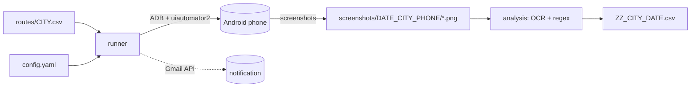

# Design Document — AppAutomation

Version 2.0 · 2026-10-17 · Status: implemented

Covers *how* the tool is built and why. Requirements live in
[`REQUIREMENTS.md`](REQUIREMENTS.md), quality assurance in
[`TEST_PLAN.md`](TEST_PLAN.md), future multi-device work in
[`MULTI_DEVICE_PLAN.md`](MULTI_DEVICE_PLAN.md).

---

## 1. Context

One process owns one phone. The same process (or another one, with
`--analyse`) turns the captured images into structured data.

## 2. Module map

| Module | Responsibility |
|--------|----------------|
| `cli.py` | Argument parsing, config resolution, run/analyse dispatch |
| `config.py` | YAML → `Config`/`PhoneConfig`/`EmailConfig` dataclasses, search order |
| `constants.py` | Static tables: cities, `TASK_APPS`, `SCREEN_PROFILES`, `CHARGE_MAP`, `RESULT_FIELDS` |
| `naming.py` | Task-name parsing, address expansion, file-name/exists helpers |
| `routes.py` | CSV loading and route selection (`read_routes`, `select_routes`) |
| `device.py` | ADB/uiautomator2 connection (with atx-agent restart), wake & unlock |
| `runner.py` | Orchestration: `RunParams`, recording loop, retries, analysis hand-off |
| `apps/base.py` | `App` ABC + `AppNotReadyError`; screenshot naming lives here |
| `apps/ui_resource.py` | Selector DSL over uiautomator2: wait/click/input primitives |
| `apps/{bolt,indrive,google_maps}.py` | Concrete drivers (package, activity, flow, suffixes) |
| `analysis/engines.py` | `OcrEngine` ABC + EasyOCR/PaddleOCR/Tesseract back-ends, `create_engine` |
| `analysis/parser.py` | Screenshot → fields (crop, dispatch by suffix, regex extraction) |
| `analysis/analyser.py` | Batch: routes + screenshots → `ZZ_<CITY>_<DATE>.csv` |
| `text_utils.py` | OCR text → numbers (`to_float`, `search_price`, Google info parsers) |
| `notify.py` | Optional Gmail send (OAuth desktop flow, `token.json` cache) |

## 3. Key design decisions

### D1 — Task names instead of per-run app lists
`--city BOLT_MEL` encodes *which apps* (`BOLT` prefix) and *which route file*
(`MEL`) in one token. `TASK_APPS` maps task keys to ordered app keys;
`NO_ANALYSIS_TASKS` opts tasks out of OCR. Chosen over a CLI app list because
it keeps the command short, is cron-friendly, and makes the route-file ↔
app-set pairing explicit.

### D2 — Drivers are classes behind a registry
`App` (ABC) fixes the lifecycle contract: class-level `package`, `activity`,
`required_suffixes`; instance gets `(dev, route_id, pickup, destination, city,
date, output_dir)`; `get_info() -> bool` does the work;
`AppNotReadyError` signals "app unusable, abort the run" (e.g. logged out) —
distinct from a per-route `False`, which the runner retries. `APP_REGISTRY`
maps short keys to classes so the runner stays driver-agnostic.

### D3 — Selector DSL (`UiResource`)
App flows read like a list of user actions (`rh.wait(idx='textContainer')`,
`rh.text_operation('Dropoff location', 'exists', 'click')`). The class wraps
uiautomator2 with: per-app resource-id prefixes (`ID_PREFIXES`), polling waits
(`max_wait` × `delay`), the "click twice" reliability idiom, and logging of
every lookup — unattended runs are debuggable from the log file alone.

### D4 — Screenshot naming is the analysis contract
`<CITY><DATE><ID:03d><SUFFIX>.png` ties capture to OCR: suffix codes are keys
into `SCREEN_PROFILES[profile]` crop boxes, and `required_suffixes` lets the
runner detect incomplete routes without understanding app internals.
`G` screenshots are upgraded from alternatives (`G0`/`G1`) at analysis time.

### D5 — Screen profiles in code, not config
Crop regions are pixel boxes tuned per resolution; they change only with new
hardware, not per deployment. Keeping them in `constants.SCREEN_PROFILES`
(marked clearly, documented in README) avoids config drift; a phone selects a
profile by name. Trade-off: adding a resolution means a code change, which is
acceptable at this scale.

### D6 — OCR behind a tiny interface, heavy imports lazy
`OcrEngine.read_lines/read_text` is the whole contract; engines load their
SDK inside `__init__`, so the package imports and the CLI runs (`--capture-only`)
with none of EasyOCR/Paddle/Torch installed. `create_engine("auto")` falls
back in accuracy order.

### D7 — Config dataclasses with fail-early validation
YAML is read once into typed dataclasses; unknown phone aliases raise before
any device contact. Secret material (OAuth client, token) is only referenced
by path.

### D8 — Robustness policy
Per-route exception → log + `False` + one retry → skip route; ≥ 3 consecutive
failures → notify + exit(1); app unusable → `AppNotReadyError` → notify +
exit(1). `finish_task`-style exit always releases the phone (uiautomator
reset, screen off). Random inter-route sleeps keep request patterns human-like.

## 4. Data flow

1. **Capture** — `select_routes` filters the city CSV; per route, per app:
   `app_start(stop=True)` → dismiss dialogs → enter addresses →
   `screenshot(suffix)` per fare screen → `True/False`.
2. **Analysis** — for each route id: parse `B` (mtime → date/time, price with
   discount pattern fallback), `BI` (label→value lines mapped through
   `CHARGE_MAP`, including range brackets like `0-12` km), `G`/`G0`/`G1`
   (distance + duration, two pattern levels). Rows are written in
   `RESULT_FIELDS` order; `src`/`dst` are punctuation-stripped.

## 5. Concurrency model (current)

Single-threaded, single-device per process. Parallelism today = launch one
process per phone manually (directories are already phone-namespaced). A
designed orchestration layer is specified in [`MULTI_DEVICE_PLAN.md`](MULTI_DEVICE_PLAN.md)
and is intentionally **not** in v2.

## 6. Extension points

* **New app** — driver file (`apps/my_app.py`), one `APP_REGISTRY` entry, one
  `TASK_APPS` entry, `ID_PREFIXES` entry; see README "Extending".
* **New phone** — `phones:` config entry; add a `SCREEN_PROFILES` entry if its
  resolution differs.
* **New OCR engine** — subclass `OcrEngine`, register in `create_engine`.
* **New city** — `CITY_NAMES` (+ state/country) and a routes CSV.

## 7. Known limitations

* Bolt fare-detail labels (`CHARGE_MAP`) are locale-dependent (English
  locales); a locale change requires label updates, not code changes.
* Suggestion taps on maps are relative-coordinate clicks (`0.3, 0.125` …);
  large UI redesigns shift them and require recalibration.
* Analysis assumes the `hd720`-style profile matches the capture device —
  capture and analysis must use the same profile.
* `TIME_*` scheduling is wall-clock in local time with a fixed
  `TIME_DIFFERENCE` offset; DST transitions are not handled.
