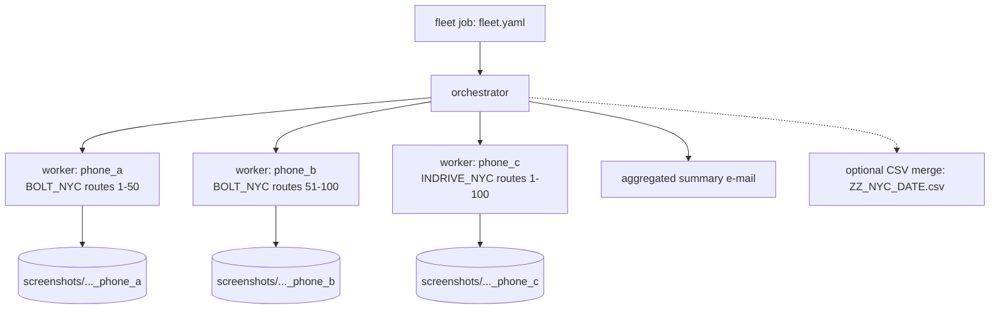

# Design Proposal — Multi-Device, Multi-App Parallel Operation

Status: proposal (planned next) · 2026-10-17 · Depends on v2 architecture
([`DESIGN.md`](DESIGN.md))

Goal: record the same route list across **several phones and several apps
concurrently**, cutting a 4-app × 100-route sweep from ~4 sequential runs to
one wall-clock pass, while keeping the failure isolation and data quality of
the single-device runner.

---

## 1. Current state & constraints

* One process owns one phone (`device.connect(serial)` → uiautomator2).
* Output is already conflict-free across devices:
  `screenshots/<DATE>_<CITY>_<PHONE>/` and per-run logs include the phone alias.
* Hard constraint: **a phone has one screen** — two apps cannot be driven on
  one device at the same time. The unit of concurrency is therefore the
  *device*, never the app.
* ADB is multi-device safe (`adb -s <serial>`); `atx-agent` runs per device.
* OCR analysis is CPU/GPU-heavy (EasyOCR) and must not be run N-times
  concurrently on one workstation without bounding memory.

## 2. Concurrency model

**Process per device** (not threads): each worker reuses the existing,
proven single-device path (`runner.run`/`analyse`), gets OS-level crash
isolation (one wedged uiautomator2 connection cannot take down the fleet),
and sidesteps any shared-state questions. An `Orchestrator` process owns the
job definition, spawns workers, and aggregates results.



## 3. Job definition (fleet.yaml, git-ignored)

```yaml
work_base: ./workspace
parallelism: 3            # max concurrent workers (<= number of phones)

jobs:
  - phone: phone_a
    task: BOLT_NYC
    date: "0000"
    routes: {mode: split, parts: 2, index: 0}   # static partition, part 0/2
  - phone: phone_b
    task: BOLT_NYC
    date: "0000"
    routes: {mode: split, parts: 2, index: 1}   # part 1/2
  - phone: phone_c
    task: INDRIVE_NYC                            # split by app: whole range
    date: "0000"

analysis:
  mode: central            # central | per-worker | none
  max_workers: 1           # bound OCR memory (EasyOCR model instances)
merge_csv: true            # concat per-run ZZ CSVs -> ZZ_NYC_DATE.csv
```

Two splitting strategies cover the real use cases:

* **split-by-routes** — same task, route range partitioned across identical
  phones (throughput mode).
* **split-by-app** — different tasks on different phones over the same routes
  (comparison mode: Bolt on A, inDrive on B, Maps on C, all observing route N
  at roughly the same time).

## 4. Component design

| Component | Responsibility |
|-----------|----------------|
| `orchestrator.py` | Load `fleet.yaml`, validate phones/tasks, spawn worker subprocesses (`subprocess.Popen` of the existing CLI), collect exit codes |
| Worker | The unchanged v2 CLI run — no runner changes required for split-by-routes; split-by-app needs no changes either (each job is a normal task) |
| Route partitioner | Static split (contiguous blocks) or dynamic work queue (SQLite/file-lock claim table: `claim WHERE phone=? AND status='pending'`) — dynamic mode is phase 3 |
| Analysis scheduler | Queue of completed capture jobs; runs `--analyse` with a bounded worker pool (default 1) so EasyOCR memory stays flat |
| Aggregator | Concatenate per-run CSVs into `ZZ_<CITY>_<DATE>.csv`; per-phone status table; one summary e-mail replacing N single-run e-mails; feed the merged file to `--report` for a cross-phone comparison page |
| Watchdog | Worker heartbeat (log mtime); a worker silent > threshold is killed and its routes marked failed, not retried blindly |

## 5. Failure & isolation policy

* Worker exit codes feed the summary; **one failing phone never stops others**.
* Per-worker retry stays inside the existing runner policy (retry once,
  abort after 3 consecutive route failures).
* Orchestrator-level retry: a failed job may be re-queued once with
  `--partial`-style id selection (routes that lack `required_suffixes`
  screenshots — the redo detection already exists in v2).
* Notification: single aggregated e-mail with a per-phone table
  (`phone / task / routes / ok-fail / csv path`).

## 6. Risks & mitigations

| Risk | Mitigation |
|------|------------|
| USB bandwidth / hub instability with 4+ devices | Powered hub; cap `parallelism`; per-device watchdog |
| App-side rate limiting or account flags from parallel identical traffic | Keep the existing randomised inter-route pauses; stagger job start times; never exceed one device per account |
| Device thermal throttling during long sweeps | Cap concurrent recording time per phone per job; cool-down between jobs |
| OCR memory blow-up with N parallel analysers | Central analysis with `max_workers` bound (default 1) |
| Same route captured at different times by split-by-app (fare drift) | Stagger job starts minimally; record capture mtime per screenshot (already in CSV `date`/`time`) |
| adb server restart mid-fleet | Workers detect disconnect (existing retry), orchestrator retries job once |

## 7. Phased implementation plan

| Phase | Deliverable | Acceptance criteria | Est. effort |
|-------|-------------|---------------------|-------------|
| P0 — Spike | Manual: two processes, two phones, hand-split ranges | Both complete; no path collisions; merged CSV by script | 0.5 day |
| P1 — Orchestrator MVP | `fleet.yaml` + `orchestrator.py`, static split, per-worker logs, summary e-mail | 3 phones / 2 apps over 100 routes; all-or-clearly-reported failures; single e-mail | 2–3 days |
| P2 — Central analysis + merge | Bounded analysis pool, CSV aggregation | One `ZZ_<CITY>_<DATE>.csv` per fleet job; OCR memory flat with N phones | 1–2 days |
| P3 — Dynamic work queue | SQLite claim table, orchestrator-level retry | Rebalancing when a phone dies mid-run; no route captured twice | 2 days |
| P4 — Observability | Per-phone run history, success-rate metrics, optional dashboard | Fleet success rate visible per day | 2 days |

New tests (per [`TEST_PLAN.md`](TEST_PLAN.md)): unit tests for the partitioner
(no gaps/overlaps; N×M coverage) and aggregator; component test for
orchestrator spawning with fake worker script; system scenario S7 "3-device
fleet, one device unplugged mid-run → others complete, failed job re-queued
once".

## 8. Non-goals

* Driving two apps concurrently on one phone (impossible by construction).
* Distributed execution across machines (the orchestrator design keeps the
  door open — workers are just CLI processes — but is out of scope).
* UI automation quality changes: parallelism must not alter per-device
  behaviour (pauses, retries) that keeps traffic human-like.
